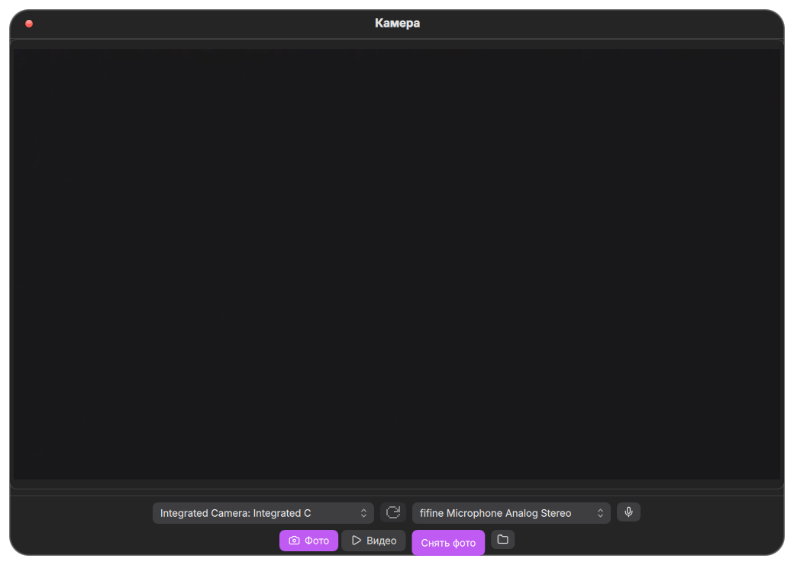
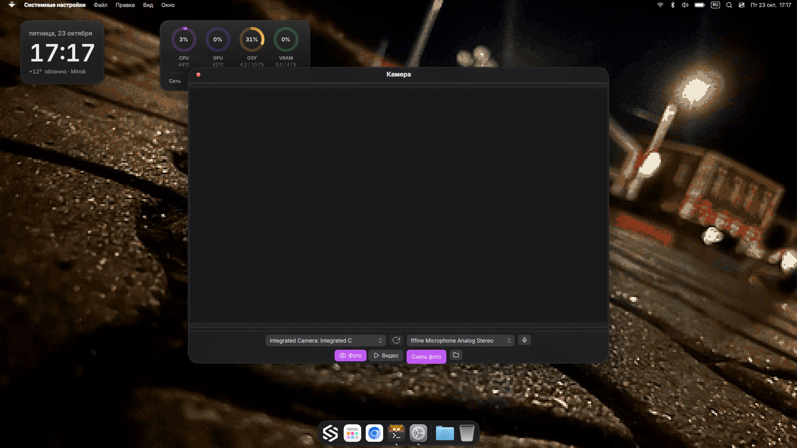

# angelOS · Камера

Плагин камеры для angelOS (Quickshell): предпросмотр, фото и видео,
переключение камер и микрофонов, обе темы оболочки — «пиксельная» и macOS «Golden Gate».

Окно в macOS-теме выглядит так:



…и на рабочем столе angelOS (ноутбучный монитор eDP-1):



## Возможности

- **Фото** — JPG / PNG / WebP на выбор, качество VeryHighQuality.
- **Видео** — MP4 (H.264 + AAC) или MKV (H.264 + Opus), частота кадров — как выбрали или «сама решит».
- **Смена камеры на ходу** — если в системе их несколько, выпадающий список меняет
  камеру даже во время записи: запись сперва аккуратно дописывается, потом камера меняется.
- **Смена микрофона на ходу** — то же самое с микрофонами (в том числе внешние, например USB).
- **Две темы** — пиксельная (96-е окна) и macOS «Golden Gate» рисуются одной разметкой,
  цвет брони берётся из темы, свои цвета шва не видно.
- **Ачивки** — «первый кадр», «первое видео» и цель «побывать на десяти камерах».

Файлы складываются в `~/Pictures/Photos` (фото) и `~/Videos/Camera` (видео);
обе папки можно перенести в настройках плагина.

## Установка

### Вариант 1 — GitHub-ссылка (даёт авто-обновление)

Настройки → Плагины → поле «Не из каталога» →

```
https://github.com/aydevix/angelos-camera
```

…и кнопка «Поставить». Взят последний релиз (или свежий коммит), обновления проверяются
вместе с каталогом раз в день, перед обновлением делается снапшот (откат работает всегда).

### Вариант 2 — .zip файлом

Скачать свежий `angelos-camera.zip` со страницы релизов и в
Настройки → Плагины нажать «Выбрать .zip…».

## Использование

- **Открытие** — сочетание записывается на собственной странице настроек плагина
  (Настройки → Плагины → Камера) либо через пункт меню рабочего стола.
  Из вручную: `qs -c angelos ipc call camera open`.
- **Закрытие** — только крестик в окне (сначала допишет видеофайл, потом закроется)
  или системная комбинация закрытия: **Win+Q** (пиксельная тема) / **Mod+W** (macOS-профиль).
  Esc и щелчки «в сторону» ничего не закрывают — окно захватника нельзя склонить к отключению
  случайно; при закрытии композитором во время записи файл просто не уцелеет.
- **Папки** — кнопка папки открывает то, чем занято приложение: фото — `~/Pictures/Photos`,
  видео — `~/Videos/Camera`.

## Требования

- angelOS (Quickshell, версия с модулями `qs.widgets` / `qs.services`).
- Пакет Qt6 Multimedia (`qt6-multimedia`) — прямо как для системного «Снимки и запись».

## Как это работает

- `Main.qml` — фоновый сервис плагина: IPC-таргет `camera` (`open|close|toggle`),
  синхронизация хоткеев через `services/Keybinds` (те же операции, что и у штатных
  сочетаний), FloatingWindow для `App.qml`.
- `App.qml` — интерфейс камеры (`QtMultimedia`): предпросмотр `Camera`,
  снимки `ImageCapture.captureToFile`, запись `MediaRecorder` с группой `mediaFormat`,
  тёплое ожидание камеры без свойства «статус» (в Qt 6 у `Camera` его нет).
- `Settings.qml` — страница настроек: формат и качество фото, контейнер и fps видео,
  папки, запись хоткеев открытия. Всё хранится через `plugin.set(...)`.
- Крестик окна даёт рекордеру добить файл (`requestClose` → стоп записи → `closeRequested`
  только после `MediaRecorder.StoppedState`), и лишь затем окно закрывается.

## Лицензия

MIT — см. [LICENSE](LICENSE).
